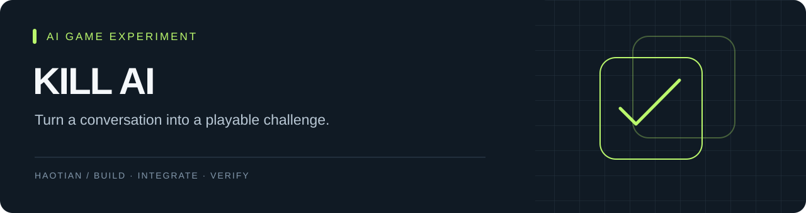

# 决战 AI · Kill AI

一个把 AI 对话变成回合制挑战的微信小程序：玩家通过表达影响「混沌值」与「预测值」，在有限回合中争取胜利。

**微信小程序 · JavaScript · 微信云开发 · 豆包 API**
状态：实验项目 / 需要自己的小程序账号与云环境

## 有什么不同

- 模型负责回复与评分，独立规则引擎计算状态变化、复活与胜负。
- 对话、道具、分享、结果动画与事件上报按职责拆分。
- 云端异常时有本地回复兜底；兜底不代表真实模型调用成功。
- 包含对局管理后台、上报重试和事件去重处理。

## 本地导入

1. 使用微信开发者工具导入本目录，配置自己的 AppID。
2. 将 `project.config.json` 中的 `YOUR_WECHAT_APP_ID`、`app.js` 中的 `YOUR_CLOUD_ENV_ID` 替换为自己的配置。
3. 在自己的云环境安装、部署所需云函数；在云端配置 `DOUBAO_API_KEY`。管理接口另需 `ADMIN_API_TOKEN`。
4. 如使用 `createIndexes`，先配置其中的云环境占位符，并确认只操作自己的测试集合。
5. 创建测试对局，验证回复、数值变化、结算和后台记录。

云集合与模块说明见 [架构说明](README_架构说明.md)。本次发布未操作任何微信云环境，也未完成微信真机端到端验收。

## 管理后台

```sh
python3 -m pip install -r requirements.txt
# 根据 .env.example 创建本地 .env 并填写自己的凭据
python3 start-admin.py
```

后台代理仅供本机开发，不能直接作为公网管理服务。不要公开代理端口或项目目录；`.env` 不得提交。音效文件未随仓库提供，缺少音效不会阻止主流程。

## 阅读代码

- `utils/battle-engine.js`：数值规则。
- `utils/battle-ai.js`：AI 返回解析与本地兜底。
- `utils/battle-reporter.js`：事件上报与补发。
- `cloudfunctions/`：模型调用、登录、记录和管理接口。

→ [系统地图](SYSTEM-MAP.md) · [发布检查](docs/PUBLISH-CHECKS.md)
